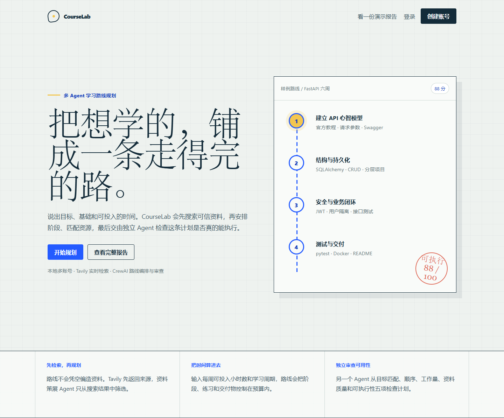
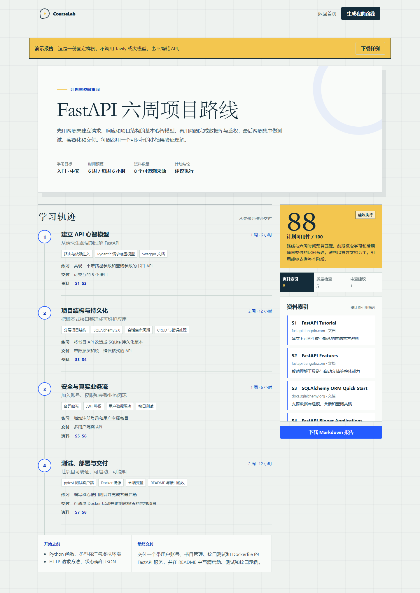
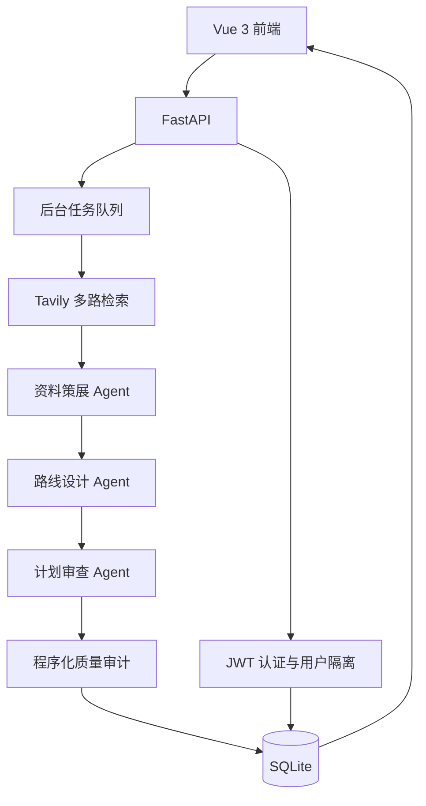

<div align="center">

# CourseLab

### Evidence-first AI learning route planner

输入学习目标、现有基础和可投入时间，自动检索可信资料，生成分阶段学习路线，
并对路线的工作量、资料覆盖和执行可行性进行独立审查。

[](https://www.python.org/)
[](https://fastapi.tiangolo.com/)
[](https://vuejs.org/)
[](https://www.crewai.com/)
[](https://tavily.com/)
[](https://github.com/DragonUaena/CourseLab/actions/workflows/ci.yml)

[产品概览](#产品概览) ·
[核心能力](#核心能力) ·
[架构](#系统架构) ·
[快速开始](#快速开始) ·
[使用方式](#使用方式) ·
[API](#api) ·
[FAQ](#faq)

</div>



## 产品概览

通用聊天模型可以快速列出知识点，但一份真正可执行的学习计划需要同时回答三个问题：

1. 学习顺序是否符合知识依赖？
2. 推荐资料是否真实存在、内容相关并能够支撑对应阶段？
3. 总工作量是否适合学习者的时间和基础？

CourseLab 使用 CrewAI 编排多个专职 Agent，通过 Tavily 获取实时搜索结果，
再结合结构化校验对生成结果进行复核。系统不仅生成路线，也保留每条路线引用的来源、
阶段交付物和审查评分，便于执行与复查。

项目面向本地自托管场景，支持多账号、用户数据隔离、API Key 加密保存和 Markdown 报告导出。



## 核心能力

| 能力 | 说明 |
| --- | --- |
| 实时资料检索 | Tavily 根据主题、目标和项目实践需求执行多路搜索并去重 |
| 资料策展 | 资料 Agent 只从搜索证据中筛选来源，路线不直接编造 URL |
| 自适应路线设计 | 根据基础、总周期和每周时间安排先修、核心知识、练习与综合项目 |
| 独立计划审查 | 审查 Agent 从目标匹配、学习顺序、工作量、资料质量和可执行性五个维度评分 |
| 程序化质量检查 | 自动检查阶段资料覆盖、周数一致性、引用数量和综合项目完整性 |
| 多用户隔离 | JWT 身份认证，所有计划通过用户 ID 在服务端强制隔离 |
| 密钥安全 | Tavily 和模型 API Key 使用 Fernet 加密后保存，并可随时清除 |
| 异步任务 | 搜索、编排、审查在后台队列中执行，页面实时展示进度和耗时，并支持主动停止 |
| 详细报告 | 包含阶段目标、分步安排、验收标准、项目要求、来源依据和审查结论 |
| 用量控制 | 限制检索来源数和输入片段，避免重复投喂原始资料，并记录实际 token |
| 报告导出 | 将详细路线、评测结果、来源元数据和引用资料导出为 Markdown |
| 零费用演示 | 内置完整演示报告，不调用 Tavily 或大模型 |

## 系统架构



### Agent 协作流程

```text
学习目标与时间预算
        │
        ▼
Tavily 四路检索 + URL 去重
        │
        ▼
资料策展 Agent ── 根据相关性、难度和用途筛选来源
        │
        ▼
路线设计 Agent ── 安排阶段、知识点、练习和交付物
        │
        ▼
计划审查 Agent ── 五维评分、风险与改进建议
        │
        ▼
程序审计 ── 周数、引用覆盖、资料数量和最终项目检查
        │
        ▼
路线 + 资料索引 + 评分报告
```

## 技术栈

| 模块 | 技术 |
| --- | --- |
| 多 Agent 编排 | CrewAI |
| 实时检索 | Tavily Python SDK |
| Web API | FastAPI、Pydantic |
| 数据持久化 | SQLAlchemy、SQLite |
| 身份认证 | PyJWT、Argon2 |
| 密钥保护 | Cryptography / Fernet |
| 前端 | Vue 3、Vue Router、Vite |
| 测试 | pytest、FastAPI TestClient |
| 持续集成 | GitHub Actions |

## 快速开始

### 环境要求

- Python 3.10 或更高版本
- Node.js 20 或更高版本
- npm 10 或更高版本
- Tavily API Key
- 任一 LiteLLM 兼容的大模型 API Key

### 1. 获取代码

```bash
git clone https://github.com/DragonUaena/CourseLab.git
cd CourseLab
```

### 2. 安装后端依赖

Windows PowerShell：

```powershell
python -m venv .venv
.\.venv\Scripts\Activate.ps1
python -m pip install -e ".[dev]"
Copy-Item .env.example .env
```

macOS / Linux：

```bash
python3 -m venv .venv
source .venv/bin/activate
python -m pip install -e ".[dev]"
cp .env.example .env
```

### 3. 安装前端依赖

```bash
cd frontend
npm install
cd ..
```

### 4. 启动应用

Windows 可以一键启动：

```powershell
.\scripts\start-dev.ps1
```

macOS / Linux：

```bash
./scripts/start-dev.sh
```

也可以分别启动后端和前端。

```bash
# 终端 1
uvicorn app.main:app --reload

# 终端 2
cd frontend
npm run dev
```

打开：

- 应用：<http://127.0.0.1:5173>
- API 文档：<http://127.0.0.1:8000/docs>
- 演示报告：<http://127.0.0.1:5173/demo>

## 使用方式

### 查看无 API 演示

打开 `/demo` 即可查看完整的 FastAPI 六周学习路线、资料引用、质量评分和审查建议。
演示报告使用内置数据，不会访问 Tavily 或大模型。

### 配置模型服务

1. 注册并登录 CourseLab。
2. 打开“模型设置”。
3. 填写 Tavily API Key。
4. 填写大模型 API Key。
5. 选择 LiteLLM 格式的模型名，例如：
   - OpenAI：`openai/gpt-4o-mini`
   - DeepSeek：`deepseek/deepseek-chat`
   - OpenAI 兼容网关：填写对应的 API Base URL 和模型名。

### 生成学习计划

1. 点击“生成计划”。
2. 填写想学习的主题、最终目标、当前基础和资料语言。
3. 设置每周可投入小时数与计划周期。
4. 提交后等待资料检索、路线编排和计划审查完成。
5. 生成期间会实时显示计时；不需要继续时可点击“停止生成”。
6. 在报告中查看分阶段计划、验收标准、阶段资料依据、质量检查和审查建议。
7. 下载 Markdown 报告或保留在个人路线列表中。

停止会立即把任务标记为已停止，并在当前 Agent 步骤结束时终止后续步骤。已经发出的单次模型或 Tavily 请求无法撤回，但后续步骤不会再消耗 token。

## 配置

CourseLab 从 `.env` 和进程环境变量读取配置。

| 变量 | 默认值 | 说明 |
| --- | --- | --- |
| `COURSELAB_SECRET_KEY` | 本地开发默认值 | JWT 签名密钥，正式环境必须更换 |
| `COURSELAB_CREDENTIAL_KEY` | 自动生成 | 用户 API Key 的加密密钥 |
| `COURSELAB_DATABASE_URL` | `sqlite:///./data/courselab.db` | SQLAlchemy 数据库连接地址 |
| `COURSELAB_ACCESS_TOKEN_MINUTES` | `10080` | 登录令牌有效分钟数 |
| `COURSELAB_CORS_ORIGINS` | `http://localhost:5173,...` | 允许的前端来源，逗号分隔 |
| `TAVILY_API_KEY` | 空 | 可选的共享 Tavily 默认 Key |
| `OPENAI_API_KEY` | 空 | 可选的共享模型默认 Key |
| `OPENAI_API_BASE` | 空 | OpenAI 兼容接口地址 |
| `COURSELAB_LLM_MODEL` | `openai/gpt-4o-mini` | LiteLLM 模型名 |
| `COURSELAB_TAVILY_RESULTS_PER_QUERY` | `4` | 每路 Tavily 检索返回数量 |
| `COURSELAB_TAVILY_MAX_SOURCES` | `12` | 去重后最多保留的来源数量 |
| `COURSELAB_PROMPT_SOURCE_CHARS` | `420` | 单个来源进入提示词的最大字符数 |
| `COURSELAB_LLM_MAX_TOKENS` | `12000` | 单次模型输出与推理额度上限；上限不等于实际消耗 |
| `COURSELAB_LLM_REASONING_EFFORT` | `low` | 推理模型的思考强度，支持 `minimal`、`low`、`medium`、`high` |
| `COURSELAB_LLM_FALLBACK_MODEL` | 空 | 主模型返回 429 时自动切换的兼容模型 |
| `COURSELAB_LLM_RATE_LIMIT_COOLDOWN_SECONDS` | `60` | 主模型限流后跳过它的冷却时间 |

用户也可以在网页中配置自己的 Key。Key 会由后端加密保存，不会原样写入数据库或返回浏览器。
保存后可勾选“清除 Key”移除当前账号的密钥；留空提交仍表示保留已有值。

## API

| 方法 | 路径 | 功能 |
| --- | --- | --- |
| `GET` | `/api/health` | 服务健康检查 |
| `POST` | `/api/auth/register` | 注册并获取访问令牌 |
| `POST` | `/api/auth/login` | 登录并获取访问令牌 |
| `GET` | `/api/auth/me` | 获取当前用户 |
| `GET` | `/api/settings/credentials` | 查询 Key 配置状态 |
| `PUT` | `/api/settings/credentials` | 保存用户 Key 和模型配置 |
| `POST` | `/api/plans` | 创建学习计划任务 |
| `GET` | `/api/plans` | 获取当前用户的学习计划 |
| `GET` | `/api/plans/{id}` | 获取计划详情和生成进度 |
| `POST` | `/api/plans/{id}/retry` | 重新生成已结束计划 |
| `POST` | `/api/plans/{id}/stop` | 停止排队或生成中的计划 |
| `DELETE` | `/api/plans/{id}` | 删除计划 |
| `GET` | `/api/plans/{id}/report` | 下载 Markdown 报告 |
| `GET` | `/api/demo` | 获取无 API 演示报告 |

完整请求和响应结构可在 `/docs` 中查看。

## 项目结构

```text
CourseLab/
├── app/
│   ├── api.py              # FastAPI 路由
│   ├── auth.py             # 用户认证与密码处理
│   ├── config.py           # 环境配置
│   ├── course_crew.py      # CrewAI Agent、任务与质量审计
│   ├── credentials.py      # 用户 Key 加密与解析
│   ├── demo_data.py        # 无 API 演示报告
│   ├── models.py           # SQLAlchemy 数据模型
│   ├── research.py         # Tavily 检索
│   ├── worker.py           # 后台生成队列
│   └── main.py             # 应用入口
├── migrations/             # Alembic 数据库迁移
├── frontend/
│   ├── src/components/     # 应用外壳与报告组件
│   ├── src/views/          # 登录、路线、测评和设置页面
│   ├── src/api.js          # 前端 API 客户端
│   └── src/styles.css      # 响应式视觉系统
├── tests/                  # API、配置与计划逻辑测试
├── scripts/                # 本地启动脚本
├── output/playwright/      # README 截图
├── .env.example
└── pyproject.toml
```

## 数据与安全

- 默认数据库位于 `data/courselab.db`，已加入 `.gitignore`。
- 应用启动时自动运行 Alembic 迁移；已有旧版数据库会自动建立版本基线。
- SQLite 连接默认启用外键约束，删除用户时可级联清理账号数据。
- 每个学习计划关联唯一用户 ID，所有查询在服务端强制限定当前用户。
- 用户密码使用 Argon2 哈希，不保存明文。
- API Key 使用 Fernet 加密，前端只能查看“是否已配置”，不能读取原值。
- 登录令牌通过 JWT 签名，并设置有效期。
- fork 或克隆仓库不会携带本地账号、学习计划或 API Key。

## 测试

```powershell
.\.venv\Scripts\pytest.exe -q
.\.venv\Scripts\ruff.exe check app tests migrations
.\.venv\Scripts\ruff.exe format --check app tests migrations
```

```bash
cd frontend
npm run build
```

当前测试覆盖：

- 用户注册、登录与学习计划隔离
- API Key 加密与脱敏
- API Key 主动清除与模型接口地址校验
- 缺少 Key 时的失败处理
- Tavily 语言参数转换
- 阶段周数归一化
- 资料去重、数量限制和计划可用性审计
- 服务重启后的排队任务恢复与运行任务终结
- 停止生成、重试清理旧结果、报告下载和任务删除
- 生成耗时、token 用量、详细路线结构和来源元数据
- Alembic 建表与 SQLite 外键约束
- 演示报告结构
- `COURSELAB_*` 环境变量兼容性

手动创建后续迁移：

```powershell
.\.venv\Scripts\alembic.exe revision --autogenerate -m "describe change"
```

## Roadmap

- [x] Tavily 实时资料检索
- [x] CrewAI 多 Agent 路线设计与审查
- [x] 多账号与用户数据隔离
- [x] API Key 加密保存
- [x] Markdown 报告导出
- [x] 响应式 Vue 3 界面
- [ ] PostgreSQL 生产部署配置
- [ ] 学习进度打卡
- [ ] 资料链接定期健康检查
- [ ] 分享只读学习路线

## FAQ

### 没有 API Key 可以使用吗？

可以查看内置演示报告。生成个性化路线需要 Tavily 和大模型 Key。

### 推荐资料会不会是模型编造的？

路线 Agent 只返回搜索结果中的来源 ID，最终 URL 由后端根据 Tavily 原始结果补充。

### 数据保存在哪里？

默认保存在当前电脑的 `data/courselab.db`。切换到 PostgreSQL 后，可部署为集中式多用户服务。

### 为什么计划会有评分？

审查 Agent 和程序审计分别检查内容质量与结构约束，合并后形成计划可用性分数。

### 支持哪些大模型？

模型调用通过 CrewAI/LiteLLM 完成，可使用 OpenAI、DeepSeek 或其他兼容服务。

### 为什么提示 `length limit was reached`？

推理模型的输出上限同时包含内部 reasoning 和最终 JSON。如果 `reasoning_tokens` 已等于
`completion_tokens`，说明模型在写出报告前就用完了额度。默认上限已改为 12000，并对识别的
推理模型使用低思考强度；仍失败时应提高 `COURSELAB_LLM_MAX_TOKENS` 或更换非推理模型。

### 为什么生成很慢或反复出现 429？

429 表示模型服务端通道达到并发或频率上限，不是报告算法在重算。配置
`COURSELAB_LLM_FALLBACK_MODEL` 后，主模型限流会自动切换到同结构的备用模型；冷却期内
后续任务会直接使用备用模型，避免重复撞击已限流通道。

## Contributing

欢迎通过 Issue 提交问题、功能建议或资料质量反馈，也可以通过 Pull Request 改进代码与文档。

提交前建议执行后端测试、Ruff 检查和前端生产构建。
